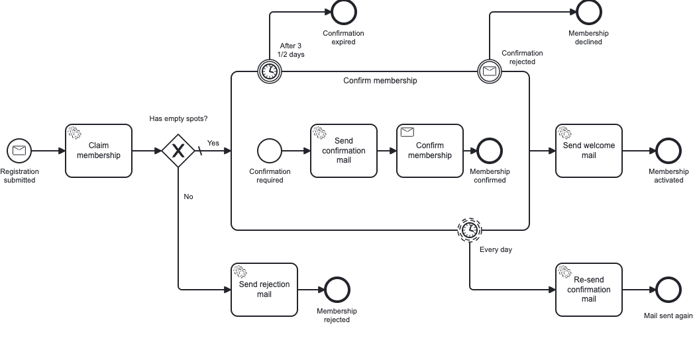
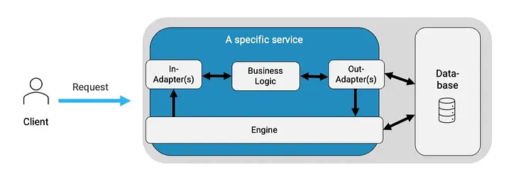
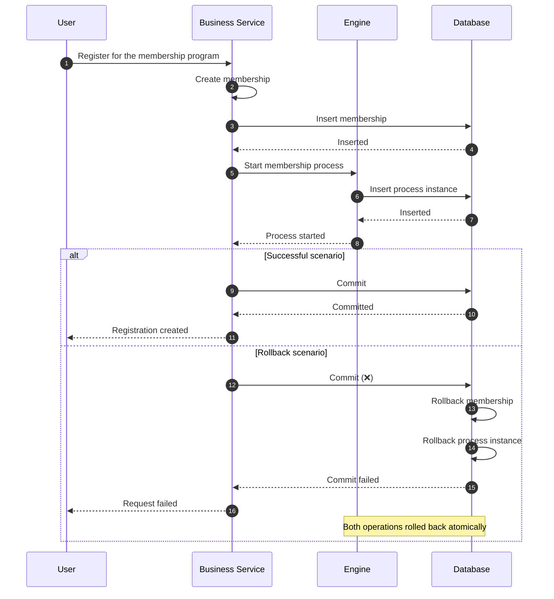
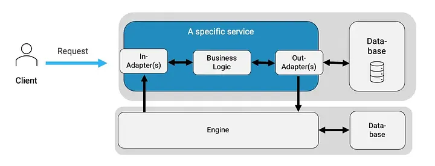
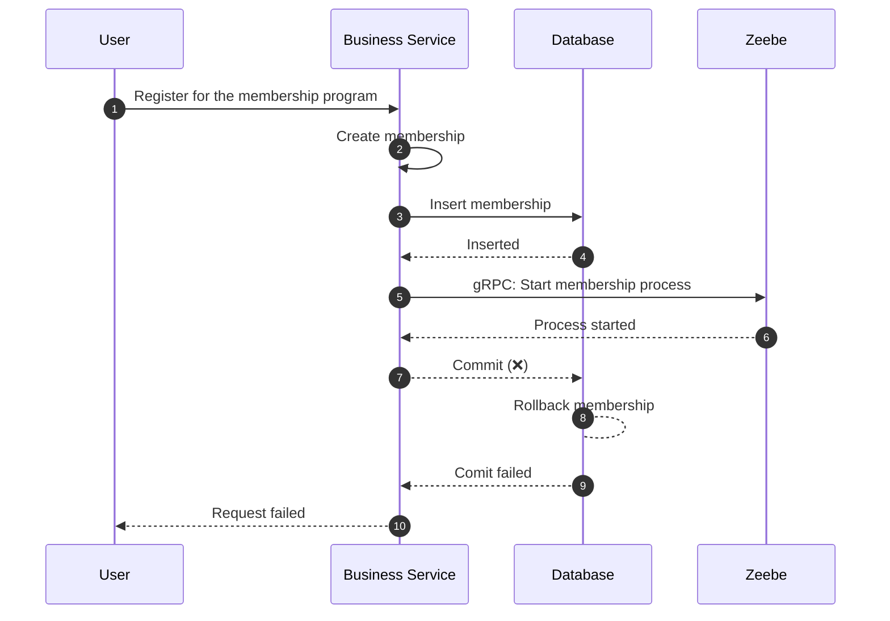
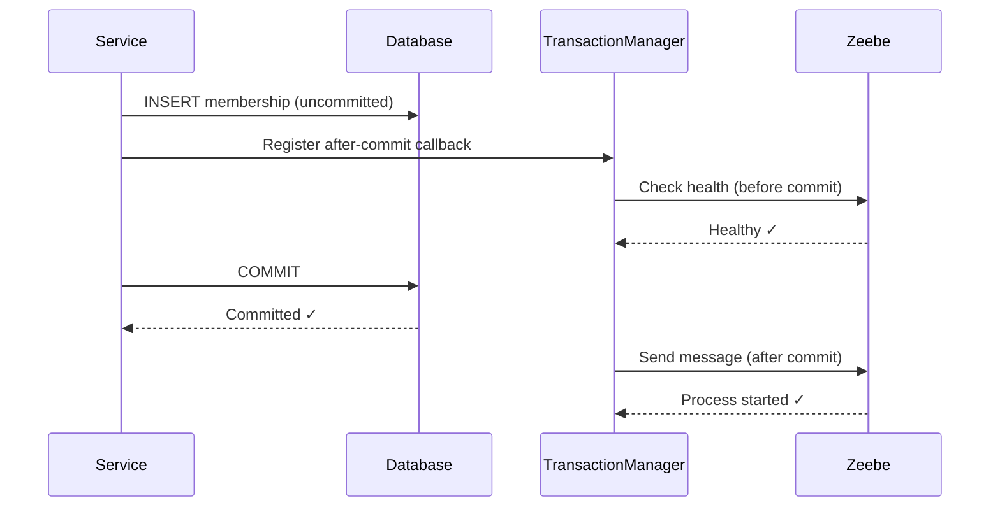
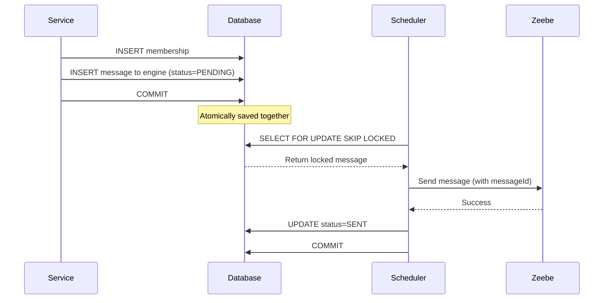
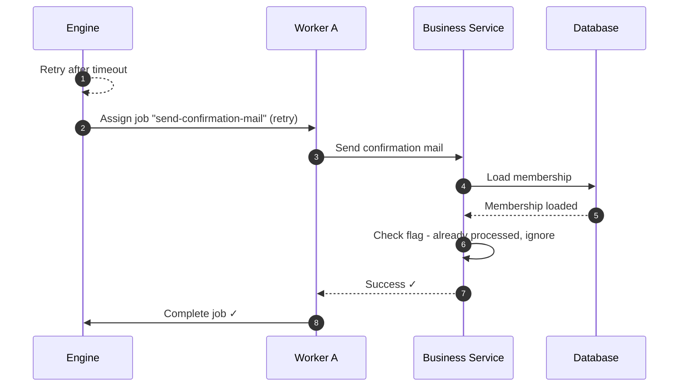
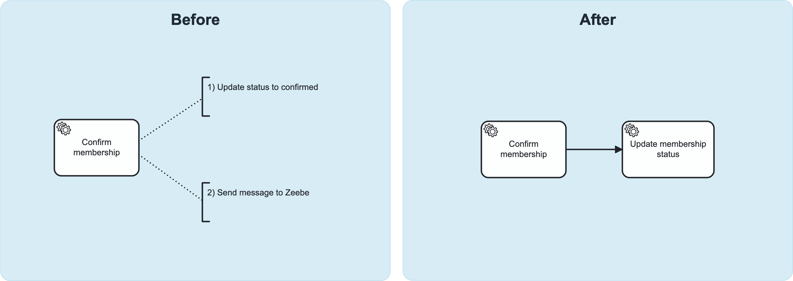
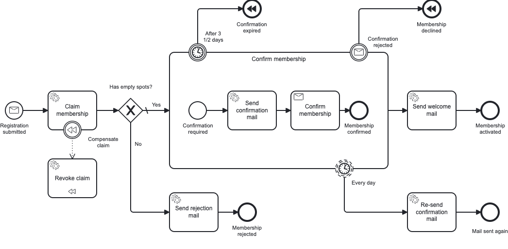

Working with Zeebe means embracing distributed systems architecture. A world that, even in 2025, remains new territory for many teams. With distributed systems comes a whole set of challenges that every team needs to understand. One of the most critical — yet often underestimated or even ignored — is **the distributed transaction problem**. And this problem will surface in your systems at some point - no matter what you’re building.

It occurs because Zeebe runs as an external service by design. Separate from your application. With its own database. Accessible only via the network. This architectural choice brings various benefits: scalability, cloud-native deployment, and resilience. But it also means — when comparing it to embedded engines like its predecessor Camunda 7 — that operations which once happened automically within a single system now span multiple systems. Systems with no shared transaction boundary. So when things go wrong, you can end up with data inconsistencies, failing processes, and coordination failures.

But here's the good news: this challenge isn't unique to Zeebe. It's a well-known problem in distributed systems with proven solutions to solve it.

This post explores these patterns and shows you how to apply them effectively. It covers After-Transaction hooks (simple but limited) and the Outbox pattern (comprehensive but complex). Moreover, it establishes idempotency as a fundamental system property you must design for when building distributed systems. Finally, it examines Zeebe-specific tools like messageIDs and BPMN itself that help both senders and receivers collaborate to maintain consistency. Based on this, it completes the overview of patterns with a look at the SAGA pattern.

Beyond implementation patterns, this post suggests how to tackle the challenges systematically: by building team awareness across your organization, identifying critical scenarios in your codebase, and prioritizing solutions based on business impact. Because solving this isn't just about implementing patterns in code—it's also about ensuring your entire team understands the challenge.

So no matter whether you're starting a greenfield Zeebe project, transitioning from Camunda 7, or already dealing with mysterious issues: This guide will help you navigate these challenges - to gain the full advantages from zeebe & your distributed system.

## **📖  Context of this post**

There's surprisingly little written about the distributed transaction problem in the context of remote process engines like Zeebe. Thus, this post is intentionally comprehensive and detailed—serving as a reference work that aims to fill this gap. However, I also plan to publish shorter, more focused articles on specific aspects in the future.

The post is based on a talk I recently gave at a Camunda University chapter and complements the [distributed-horcruxes repository](https://github.com/emaarco/distributed-horcruxes) with extensive examples of the problem and solution patterns.

## 🎮 When Production Breaks: An example scenario

Picture this: You’re running the membership program of a bike brand. It works like a newsletter, but with a limited number of spots. Your Zeebe-based membership process is working smoothly. Users register, the process claims one of the free spots for them, they get a confirmation email, confirm their membership, and receive a welcome mail. After that they receive the periodical newsletters. Everything seems fine.



Example process of the membership program - when a user registers

But from time to time, support tickets are piling up: With multiple user’s reporting the same issue: “I registered but didn’t receive a confirmation email”. For quite some time, the support team downplay’s this as user-errors. But at some points its crossing a line where you need to investigate. And doing this, you may find a disturbing pattern:

For each case, there is no membership in the database. So far, so good. But then it becomes contradictory: You can find an instance in Operate (which is Zeebe’s tools for process observability) for each case. An instance that has thrown an incident. An incident that always shows the same error message: NoSuchElementException. The task to claim a spot for the new member can’t find the membership.

It makes you realize, this isn’t a random bug. This is systematic. Something fundamental is broken. Thus, you start debugging. Your code looks correct. You are saving a membership, sending a message to zeebe. And all of this is done in one operation, that uses one transaction. So, what’s going wrong?

```kotlin
@Service
@Transactional
class RegisterMembershipService(
    private val membershipRepository: MembershipRepository,
    private val zeebeClient: ZeebeClient
) {
    fun register(email: String, name: String): MembershipId {
        // Save the membership to the database
        val membership = Membership(email = email, name = name, status = PENDING)
        membershipRepository.save(membership)
        
        // Start the process instance in Zeebe
        val variables = mapOf("membershipId" to membership.id.toString())
        zeebeClient.newPublishMessageCommand()
            .messageName("miravelo.registrationSubmitted")
            .withoutCorrelationKey()
            .variables(variables)
            .send()
            .join()
        
        return membership.id
    }
}
```

At some point the realization hits: Since Zeebe runs as a completely separate system with its own infrastructure, the `@Transactional` has absolutely no power over it. It only controls your local database transaction. 

So when the transaction fails after the message has been successfully sent to Zeebe, only your database rolls back. The membership disappears. But the process? It’s already running & executing tasks. Looking for data that does not exist. 

This is **the distributed transaction problem**—and those incidents are its signature in your production logs.

## 🏛️ Understanding the Shift: From Monolithic to Distributed

To understand why this problem propably catches many teams off guard, and why it only exists in distributed operations, we need to look at where most developers are coming from: **the monolithic, single-system world.**

For years this was the dominating pattern, where everything lived together. Business logic, database interactions, and often the process engine itself—all within one application, writing to one database, protected by one transaction per operation.



Broad architecture of a system with an embedded engine such as Camunda 7

Consider our membership service for example. REST endpoints, database adapters, and the  engine itself could coexist in a single application. The engine runs embedded as a library, sharing the application's database. This unification made operations both simple and safe:

```kotlin
@Service
@Transactional
class RegisterMembershipService(
    private val membershipRepository: MembershipRepository,
    private val runtimeService: RuntimeService  // Embedded engine
) {
    fun register(email: String, name: String): MembershipId {
        val membership = Membership(email = email, name = name, status = PENDING)
        membershipRepository.save(membership)
        
        val variables = mapOf("membershipId" to membership.id.toString())
        runtimeService.startProcessInstanceByKey(
            "membership-program",
            membership.id.toString(),
            variables
        )
        
        return membership.id
        // Transaction commits here - atomically!
    }
}
```

The service above for instance was safe, because all operations within it wrote to the same database - using the same transaction. And same transaction meant same fate. If anything failed, the whole database operation was rolled back automatically. So either the membership and the instance got saved - or neither of both:



All of this was protected by the so called **ACID** principles. They made achieving consistency straightforward - and therefore also helped when working with engines. **ACID** thereby stands for:

- **Atomicity**: Each transaction is treated as a single unit that either succeeds completely or fails completely
- **Consistency**: Transactions can only bring the database from one valid state to another, preserving all defined rules and constraints
- **Isolation**: Transactions run independently; changes from one transaction aren't visible to others until committed
- **Durability**: Once committed, changes persist permanently even in case of system failures

### 🧱 Limitations of ACID

But lets not whitewash everything: Even in this monolithic world, ACID couldn’t protect you everywhere. The moment you interacted with external systems - like email services, message brokers or REST APIs — you left its safety. Your transaction couldn’t reach across network boundaries. This means same problems existed even then. 

However, it was less visible because most operations stayed within your system. The problem only surfaced when you intentionally integrated with external services

And what is most relevant in the context of our perspective: The process engine itself wasn’t part of the problem

This relative safety was possible because embedding was an option.

## 🌐 The Distributed Reality: When Using Remote Engines

With remote engines like Zeebe, this changes. The engine itself becomes an external system you coordinate with—by design. And this shift is fundamental. 

What was once an occasional problem—when you intentionally integrated with external services—now applies to every single interaction with your process engine. Remember that embedding was your safety net. With Zeebe, that option no longer exists.

The architecture now consists of three separate pieces: your application with its database, Zeebe with its own infrastructure, and network communication in between them.



Broad architecture of a system with a remote engine such as zeebe

This means that most operations will affect two independent systems with two independent transactions. But here’s what makes this particularly deceptive—your code looks nearly identical:

```kotlin
@Service
@Transactional
class RegisterMembershipService(
    private val membershipRepository: MembershipRepository,
    private val zeebeClient: ZeebeClient
) {
    fun register(email: String, name: String): MembershipId {
        // Save the membership to the database
        val membership = Membership(email = email, name = name, status = PENDING)
        membershipRepository.save(membership)
        
        // Start the process instance in Zeebe
        val variables = mapOf("membershipId" to membership.id.toString())
        zeebeClient.newPublishMessageCommand()
            .messageName("miravelo.registrationSubmitted")
            .withoutCorrelationKey()
            .variables(variables)
            .send()
            .join()
        
        return membership.id
        // Transaction commits here - but only for the database!
    }
}
```

However, beneath the surface, everything has changed. This is because the transaction does not control your engine anymore - but only your domain’s database.

You can see the real impact when you look at a sequence diagram—but not a successful one. In the happy path, you’d only see database operations becoming gRPC calls via the network. The problem only becomes visible when things fail. And that would look like this:



The service inserts the membership into the database and sends the message to Zeebe. Zeebe acknowledges it and starts the process immediately. But then—perhaps due to a connection timeout—the commit fails. The database rolls back, making the membership disappear. However, Zeebe doesn’t know about this failure. It received the message and started executing—now looking for data that no longer exists.

That's the exception occurring in our example scenario. And it appears because we no longer have the previous ACID guarantees. Instead—with distributed architecture—we operate under a different paradigm called **BASE**. It means:

- **Basically Available**: The system remains operational even during partial failures, ensuring services continue without interruption
- **Soft State**: The system's state may change over time, even without new input, as data synchronizes across nodes
- **Eventual Consistency**: All systems will converge to the same state over time—just not instantly

But internalize one thing: This isn’t a limitation—it’s a trade-off. We’ve exchanged immediate consistency within one system for independent, resilient systems that can scale and fail independently. With ACID, operations were atomic but tightly coupled. With BASE, operations are decoupled but eventually consistent.

Take a moment to let this sink in. Your database transaction can succeed. Your process can start. Yet your system is temporarily inconsistent. This is the distributed reality—and it requires different patterns to maintain consistency across systems.

### 🪜 *A note on embedded engines like Camunda 7*

> *All these challenges can occur in Camunda 7 as well. C7 could run embedded in the same service as your business logic, or it could run in a distinct service interacting with your domain-service via the network. The difference is: embedding was an option in C7. With Zeebe, it isn’t. We’re using C7 for context—to show how systems previously looked—especially since many teams are migrating due to C7’s end-of-life. So neither approach is better or worse.*
> 

## ❌ The Universal Challenge of Distributed Transactions

This distributed reality—where systems can temporarily be inconsistent—has a name: **the distributed transaction problem**. And it's not just a Zeebe challenge. It's a fundamental characteristic of any architecture where operations span multiple independent systems.

### What It Is and Why It Exists

The core challenge is deceptively simple to explain. It states that **when an operation spans multiple independent systems, you cannot guarantee that all systems succeed or fail together.** And this opens the door to inconsistency.

In a single database with ACID, the database itself acts as a transaction coordinator. It locks resources, coordinates commits, and rolls back anything if error occur. When you cross system boundaries, no such coordinator exists. Each system manages its state independently and makes its own commit or rollback decisions—with no mechanism to make them all agree.

The result is that partial success becomes possible. One system commits successfully while another fails and rolls back. If this happens, your data is inconsistent, and there's no automatic way to fix it. Reasons for such errors are numerous - like network timeouts or availability issues. They're normal conditions in distributed systems that—even if they are rare—will happen from time to time in your system. You can never fully prevent them.

### Where This Problem Surfaces

So to repeat: The challenge occurs whenever operations coordinate across independent systems, which is a state not limited to zeebe. Generally, it can occur whenever you work with:

- **Microservices & External APIs**: A member cancels their membership. You update their status in your database and call SendGrid's API to send a confirmation email. SendGrid confirms the email was sent, but then your database commit fails. The result: The user received a confirmation email but remains an active member in your system and will continue receiving the newsletter.
- **Event-driven systems & Message queues**: An author creates a new edition of his newsletter in your content system. The content system sends it to your publishing system via Kafka. The publishing system tries to insert it into its database—but fails. It results in your publishing system having temporarily or permanently a different state than your content system.

### The Consequences

Each system boundary becomes a risk point. If the distributed transaction problem strikes at such a point and you aren’t using appropriate pattern, it manifests in destructive ways:

- **Data Inconsistencies**: Different systems - like your content- & publishing system - hold contradictory views of reality.
- **Lost or Interrupted operations**: As a result of such data-inconsistencies, work that is supposed to be performed, like publishing a new version of the newsletter, may never be performed or just partially.
- **Duplicate Operations**: This is the opposite problem. Retries that were meant to handle failures instead create duplicates. For instance, the system sends multiple confirmation mails to one member.
- **Manual Intervention**: Without automatic recovery, many of these problems require human intervention. Support teams manually reconcile data or restart processes. Developers investigate and fix corrupted states. This doesn’t scale.

These aren’t minor inconveniences. They directly impact business operations, customer trust, and system reliability.

## 🔮 The Problem in context to Zeebe

Now lets bring this all together. When you adopt Zeebe, you're building a distributed system. One where your application and Zeebe coordinate over the network. Each has its own database. Each makes independent commit decisions. Unlike with embedded engines — where the engine could share your transaction boundary — with Zeebe, that safety net is gone. 

This means, that the distributed transaction problem affects every interaction with your engine: every message you send, every job your workers process.

The specific challenges you encounter depend on your coordination patterns, error handling strategies, network reliability, system load, and transaction configuration. But certain failure scenarios emerge repeatedly across implementations and environments.

These failures cluster around two critical moments: when your application sends messages to Zeebe, and when workers acknowledge completed jobs. Understanding these manifestations helps you recognize them, design effective defenses, and choose appropriate solutions:

### Challenges When Sending Messages to Zeebe

**1. Phantom Instances: Process Runs Without Data**

This is the scenario we've already mentioned multiple times. Your application sends a message to Zeebe before committing the database transaction. It starts the process immediately. But then your transaction fails and rolls back. The result: Zeebe has a running process instance, but the business data it requires doesn't exist. Workers trying to fetch the membership get an exception.

**2. Premature Execution: Reading Uncommitted Data**

However, there are also other variants of this scenario. Even if your commit finally succeeds, the engine could execute the first task before the commit completed. This represents a timing issue (race condition) because it can result in the same scenario as above: The worker cannot yet access the data that it requires. But it could also be worse - resulting in a third problem.

**3. Premature Execution: Overwriting Data**

This scenario occurs when we execute and commit changes from a follow-up task before the previous task completes. It's especially problematic when both tasks update the same data. In such cases, we can corrupt the state. This results not just in inconsistency, but also in race conditions that require manual resolution.

### Challenges When Acknowledging Jobs

The coordination problem doesn't just affect sending messages to Zeebe—it also impacts how workers complete their jobs. Consider this scenario: A worker successfully processes a job and commits changes to your database. Everything looks good. But when the worker tries to acknowledge completion to the engine, an error occurs.

Now you face two distinct outcomes depending on *why* the acknowledgment failed:

**1. Temporary Failures—Due to Connectivity Issues**

These failures can happen for many reasons, like network problems. At this point, the job is still active from Zeebe's perspective. This means Zeebe will retry the job after a timeout. While problematic, this scenario is manageable with idempotency patterns (which we'll cover later).

**2. Permanent Failures—Due to Job Cancellation**

These failures are much harder to manage. They occur when the job gets canceled—for instance, by a boundary event that fired while your worker was processing. From Zeebe's perspective, the job is no longer active. Moreover, Zeebe doesn't know that it was executed successfully on the domain side. This creates a permanent inconsistency that's hard to detect and likely requires manual intervention to resolve.

### The Combined Reality

These scenarios aren't theoretical edge cases you can ignore. They happen regularly—even if modern infrastructure's high reliability makes them relatively rare. What makes them particularly challenging is that they don't occur in isolation. They can combine, making them even harder to detect and resolve.

The coordination patterns we'll explore in the next section address them systematically. Rather than treating each failure mode separately, these patterns provide a coherent framework for maintaining consistency across your distributed system.

For a comprehensive deep-dive into all scenarios with detailed sequence diagrams, code examples, and step-by-step analysis, check out the [distributed-horcruxes repository](https://github.com/emaarco/distributed-horcruxes).

## 🛠 Solution Patterns: Your Distributed Transaction Toolkit

Here's where we stand: we're coordinating between two autonomous systems—Zeebe and our service—each with its own database and no shared transaction boundary. Failures in either system can leave our data inconsistent.

The good news? Because distributed transactions are a generic challenge there are proven patterns. The bad news? There's no silver bullet. Each solution comes with tradeoffs, and choosing the right one depends on your specific requirements.

We'll explore your toolkit organized into three blocks: basic patterns that tackle the coordination problem directly, idempotency as your essential safety net for handling duplicate operations, and Zeebe-specific features that help you implement these patterns more effectively.

## 🎻 Block 1: Basic Orchestration Patterns

Introducing to the toolset, these patterns address how to coordinate operations across system boundaries while maintaining consistency.

### The Retry Pattern: Intuitive but Usually Wrong

When operations fail, the first instinct is usually: "just retry!" It's a common pattern in distributed systems - that is simple to implement and works great in many cases. Using for example the spring framework and its [retry-library](https://www.baeldung.com/spring-retry), you just need to add a `@Retryable` to a method. Nothing else. If an error occurs the method will be executed once again until a limit is reached.

```kotlin
@Service
@Transactional
class RegisterMembershipService(
    private val membershipRepository: MembershipRepository,
    private val zeebeClient: ZeebeClient
) {
    @Retryable(maxAttempts = 3)
    fun register(email: String, name: String): MembershipId {
        // logic to create a membership & start the process
    }
}
```

However, in the context of sending messages to a process engine like zeebe, this approach is usually wrong. To understand why, let's think about what happens when a call fails. When in this case, the entire operation is performed again - and after some retries its succesful, we have multiple process-instances in the engine, but only one membership in the database. This is an unresolved inconsistency that most likely causes issues.

**What we should learn from this is the following**: Retries are a very powerful tool in distributed systems. But when solving orchestration issues, using them as a sole solution typically creates more issues than it resolves. Retries work best when operations are idempotent—but we'll cover that later. For now we conclude, that we need a solution, which guarantees a message is sent to zeebe only after a successful commit. And this is exactly what the next pattern provides.

### After-Transaction Pattern: Simple but Limited

The  idea is elegant: Instead of calling it directly, you register the call to zeebe as a callback which will be executed after the commit succeeded. For such scenarios the SpringBoot framework for instance provides so called `TransactionSynchronization` hooks. 

An implementation that uses such hooks centers around two components. Firstly the hook itself, that implements the call to zeebe - and if useful also some pre-commit checks, to increase the certainty that the call will be successful:

```kotlin
class ProcessEngineCallSynchronization(
    private val camundaClient: CamundaClient,
    private val processEngineCall: (): Unit
) : TransactionSynchronization {
    
    private val log = KotlinLogging.logger {}
    
    override fun afterCommit() = try {
        processEngineCall()
    } catch (e: Exception) {
        log.error(e) { "Failed to execute process engine call" }
        throw e
    }
    
    override fun beforeCommit(readOnly: Boolean) {
        val topology = camundaClient.newTopologyRequest().send().join()
        val healthy = checkBrokerHealth(topology)
        if (!healthy) {
            throw IllegalStateException("No healthy broker found")
        }
    }
}
```

And secondly, a synchronizer that registers these callbacks with Spring's transaction manager. It looks up for a running transaction, and adds the synchronization to its lifecycle:

```kotlin
class ProcessEngineSynchronizer(private val camundaClient: CamundaClient) {

    fun executeAfterCommit(
        processEngineCall: () -> Unit
    ) = TransactionSynchronizationManager.registerSynchronization(
        ProcessEngineCallSynchronization(camundaClient, processEngineCall)
    )
}
```

With these components in place, your service code stays clean and expressive. It just uses the synchronizer and its `executeAfterCommit`  method to register & perform the engine-call.

```kotlin
@Service
@Transactional
class RegisterMembershipService(
    private val membershipRepository: MembershipRepository,
    private val engineSynchronizer: ProcessEngineSynchronizer,
    private val zeebeClient: ZeebeClient
) {
    fun register(email: String, name: String): MembershipId {
        // Save to database within transaction
        val membership = Membership(email = email, name = name)
        val savedMembership = membershipRepository.save(membership)
        
        // Register Zeebe call to happen AFTER commit
        engineSynchronizer.executeAfterCommit {
            zeebeClient.newPublishMessageCommand()
                .messageName("miravelo.registrationSubmitted")
                .variables(mapOf("membershipId" to savedMembership.id))
                .send()
                .join()
        }
        
        return savedMembership.id
        // Database commits first, then Zeebe call executes
    }
}
```

The execution flow shows the key difference: Zeebe only gets notified after the database commits successfully. The phantom instance problem is solved—workers always find their data because it's guaranteed to exist when the message arrives.



**Advantages**

The After-Transaction pattern offers several advantages. Your database stays consistent. The pattern is simple to understand as well as to implement. And you can even add an optional health check before commit to increase your success rate.

**Disadvantages**

But there's a critical weakness: you've just moved the problem to the other side. So instead of risking processes without data, you now risk orphaned data—meaning having memberships without processes. This is because if the Zeebe call fails after the commit the message is lost. Since there’s no persistent storage, manual intervention is needed to resolve this issue.

**Conclusion**

After-Transaction works well for non-critical scenarios and proof-of-concepts. For systems that require guaranteed delivery, with a minimum of manual intervention, you need persistency. And this is exactly what the third pattern provides.

### Outbox Pattern: The Comprehensive Solution

The outbox pattern takes a surprisingly simple approach to this complex problem: It says that if you can’t reliably coordinate across two systems, you should make it a problem in one system.

Therefore, it writes both your business data *and* the message to your database in one atomic transaction. There’s no immediate call to Zeebe—just two database writes. A background process later reads these messages and sends them to Zeebe. This restores ACID guarantees: 

👉🏽 Either both the membership and the message are saved together, or neither survives a failure.

The pattern splits the coordination challenge into two independent concerns: atomic database writes and reliable message delivery. It transforms a complex distributed problem into two simpler, manageable pieces.

**Concern 1: Atomic Write to Database and Outbox**

Your application writes both the business data and the message record to the database in a single transaction—either both are saved, or neither survives a failure. To do this it requires an additional table in your database. The outbox table. Your other tables remain untouched. The outbox acts as a staging area for messages, we need to send to Zeebe.

```sql
-- Your existing business table
-- memberships (id, email, name, status, registration_date)

-- Add this new outbox table
CREATE TABLE process_messages (
    id UUID PRIMARY KEY,
    message_name VARCHAR(255) NOT NULL,
    correlation_id VARCHAR(255),
    variables JSONB NOT NULL,
    status VARCHAR(50) NOT NULL,  -- PENDING or SENT
    retry_count INT DEFAULT 0,
    created_at TIMESTAMP NOT NULL,
    updated_at TIMESTAMP NOT NULL
);
```

When the table is in place, your business-service simply needs to save the messages to zeebe in the database as well. No network calls to Zeebe happen yet, so the transaction stays fast:

```kotlin
@Service
@Transactional
class RegisterMembershipService(
    private val membershipRepository: MembershipRepository,
    private val outboxRepository: ProcessMessageRepository
) {
    fun register(email: String, name: String): MembershipId {
        val membership = membershipRepository.save(
            Membership(email = email, name = name, status = PENDING)
        )
        
        val message = ProcessMessage(
            messageName = "miravelo.registrationSubmitted",
            correlationId = membership.id.toString(),
            variables = mapOf("membershipId" to membership.id),
            status = MessageStatus.PENDING
        )
        outboxRepository.save(message)
        
        return membership.id  // Both saved atomically
    }
}
```

**Concern 2: Background Polling and Sending**

Instead, a separate scheduler handles the communication with Zeebe. It continuously polls the outbox table for pending messages. When it finds one, it will send the message to the engine:

```kotlin
@Component
class ProcessEngineOutboxScheduler(
    private val camundaClient: CamundaClient,
    private val transactionManager: PlatformTransactionManager,
    private val repository: ProcessMessageJpaRepository,
) {
    private val log = KotlinLogging.logger {}
    private val objectMapper = ObjectMapper()

    @Scheduled(fixedDelay = 200)
    fun sendMessages() {
        log.debug { "Running scheduler to send messages to zeebe" }
        var messagesProcessed = 0
        while (processNextMessage()) messagesProcessed++
        log.debug { "Scheduler finished sending messages to zeebe" }
    }

    private fun processNextMessage() = performInTransaction {
        val message = repository.findFirstByStatusWithLock(MessageStatus.PENDING)
        if (message == null) {
            false
        } else {
            trySendMessage(message)
            true
        }
    }

    private fun trySendMessage(message: ProcessMessageEntity) {
        try {
            sendMessage(message)
            val sentMessage = message.copy(status = MessageStatus.SENT)
            repository.save(sentMessage)
            log.info { "Successfully sent message ${message.messageName}" }
        } catch (e: Exception) {
            val retryCount = message.retryCount + 1
            val retryMessage = message.copy(retryCount = retryCount)
            repository.save(retryMessage)
            log.warn(e) { "Retrying to send message ${message.messageName}" }
        }
    }

    private fun sendMessage(message: ProcessMessageEntity) {
        val variables = objectMapper.readValue(
            message.variables,
            object : TypeReference&lt;Map&lt;String, Any&gt;&gt;() {}
        )
        val messageId = "${message.correlationId}-${message.messageName}"
        
        log.info { "Sending message ${message.messageName}" }
        
        camundaClient.newPublishMessageCommand()
            .messageName(message.messageName)
            .correlationKey(message.correlationId)
            .messageId(messageId)
            .variables(variables)
            .timeToLive(Duration.of(10, ChronoUnit.SECONDS))
            .send()
            .join()
    }
}
```

The scheduler can run for instance every 200ms. Thereby, it uses database locks (`SELECT FOR UPDATE SKIP LOCKED`) to prevent race conditions—allowing multiple scheduler instances to run in parallel. If a message is got sent successfully it is marked as SENT. If sending fails, the retry counter increments and the message remains PENDING for the next polling cycle. 

As shown for the other patterns, here's how this flow looks in a sequence diagram:



**Advantages**

The outbox pattern guarantees eventual message delivery—if Zeebe is down or the request fails, the message persists in the database and will be retried. This solves all timing and reliability issues. The atomic storage ensures an all-or-nothing approach: either both the business data and the message are saved, or neither survives. This separation of concerns cleanly separates database operations from process engine interactions. Additionally, you get an audit trail since SENT messages remain in the database, and built-in retries handle failures automatically.

**Disadvantages**

But as always it's not without trade-offs. The pattern introduces additional complexity. You'll need to implement the outbox table, the scheduler, and handle additional infrastructure. Next to that, you'll experience slight delays from the polling interval—typically 100-200ms. Furthermore, you’ll need a message processing strategy. This could be safe sequential processing or faster parallel processing with ordering considerations. Messages might also be sent multiple times so mechanisms like dead letter queues are essential. Finally, as the database grows, a cleanup strategy for old messages will be necessary.

**Conclusion**

Even if the disadvantages seem a lot, for critical business processes where guaranteed delivery is essential, the outbox pattern is worth the investment & mostly without alternative. For less critical scenarios, after-transaction may suffice - but still should be used with caution. The complexity you accept today builds the reliability you depend on tomorrow.

### Why Implementing Orchestration Patterns is not enough

However, even with the outbox pattern in place, you haven't solved the distributed transaction problem as a whole. There's one more fundamental challenge to address.

Consider what happens when the scheduler fails at the wrong moment: it reads a message from the outbox, sends it to Zeebe, but crashes before marking it as SENT. When the service restarts, that message still shows PENDING. The scheduler picks it up a second time and sends it to Zeebe—again. Zeebe receives the same message twice.

This is **at-least-once delivery**—a characteristic of distributed systems where you can guarantee a message arrives, but not that it arrives exactly once. This isn't specific to the outbox pattern. Many tools work this way, including message brokers like Kafka. 

So how do you handle duplicates when they inevitably arrive?

## 🎨 Block 2: Idempotency as a Design-Pattern

The solution to this problem is called **Idempotency**. Its a design principle, commonly used in distributed systems. It ensures, that performing the same operation multiple times produces the same result as performing it once. 

Without idempotency, duplicate messages become dangerous. A member might receive multiple welcome emails, or worse—the process might claim two of the limited spots for one person. With idempotency, duplicates become harmless. To illustrate it with an example of the physical worlds, think of it as pressing an elevator button: whether you press it once or ten times, the elevator comes to your floor exactly once.

Thus, the challenge shifts from preventing all duplicates, which is impossible in distributed systems, to handling them safely. And this is achievable through design.

### Non-Idempotent Operations

Before exploring idempotency patterns, let's understand what makes an operation non-idempotent. It's the opposite of our earlier definition: an operation where repeated execution produces different results each time.

This especially applies to operations where the new state is calculated dynamically based on the current state—like incrementing counters or adjusting balances. Our membership process contains exactly such an operation: claiming a spot. The worker takes one of the limited spots and marks the membership as claimed. If no spot is left, it marks the membership as rejected:

```kotlin
fun claim(membershipId: MembershipId): Boolean {
    val membership = repository.find(membershipId)
    val hasEmptySpots = capacity.reserveSpot()  // Non-idempotent!
    val claimedMembership = if (hasEmptySpots) membership.claim() else membership.reject()
    repository.save(claimedMembership)
    return hasEmptySpots
}
```

If this operation runs twice due to a failure while acknowledging the job, two spots vanish instead of one—corrupting your capacity. Each execution changes the state in ways that compound. This is why we need explicit idempotency patterns.

### How to Achieve Idempotency

Making operations idempotent isn't one-size-fits-all. The right approach always depends on your operation's characteristics. Therefore, there are multiple approaches on how to achieve this. They include:

**Approach 1: Natural Idempotency**

Some operations are naturally idempotent—or can be redesigned to be. For example, setting a membership status to `CONFIRMED` always produces the same result, regardless of the previous state. Execute it once or ten times—the outcome remains identical.

```kotlin
fun confirmMembership(membershipId: MembershipId) {
    val membership = repository.find(membershipId)
    repository.save(membership.confirm())
}
```

This works perfectly for pure state updates without side effects—no emails, no external service calls, no events. But the moment you add side effects, natural idempotency breaks. You'll send two emails instead of one. And since most operations have such side effects, this approach has limited use, leading us to the second approach.

**Approach 2: Use the domain as an idempotency guard**

This patterns idea is to use your domain-objects to achieve idempotency. One solution that falls under this category would be, to write a flag like `confirmationMailSent` to the membership, to track whether the corresponding operation has already been executed.

```kotlin
data class Membership(
    val id: MembershipId = MembershipId(UUID.randomUUID()),
    val name: Name,
    val email: Email,
    val status: MembershipStatus,
    val confirmationMailSent: Boolean = false  // Idempotency flag
)
```

Each time the worker executes the task, no matter if its the first time or a retry, we can check this flag. When it indicates completion, we can skip the operation:



Like the first approach, this is also straightforward. But as with every previous pattern, it comes with downsides as well. Every operation requiring idempotency needs its own flag, bloating your domain model with technical concerns rather than business logic. This weakens domain design, creates maintenance overhead, and doesn't scale.

**Approach 3: Processed Operations Log**

To solve this issue, the third pattern can help: **maintaining a log of processed jobs**. Its philosophy follows the outbox pattern. Instead of cluttering the domain model with technical flags, it outsources the responsibility of achieving idempotency. Therefore, it assigns each operation a unique `operationId` and maintains a separate table that tracks which operations have already been executed.

```sql
// Separate table for tracking processed operations
CREATE TABLE processed_operations (
    operation_id VARCHAR(255) PRIMARY KEY,
    processed_at TIMESTAMP DEFAULT CURRENT_TIMESTAMP
);
```

Before processing any operation, the system checks whether its operation ID exists in this table. If it does, the execution is skipped. If not, it performs the actions required for the use case. Finally, it creates a new entry in the log table to record that it has executed the task—while once again leveraging ACID principles to ensure consistency. This is because either both the log and the business data are saved, or neither of them.

```kotlin
@JobWorker(type = "send-confirmation-email")
fun sendConfirmationEmail(job: ActivatedJob) {
    val operationId = job.key.toString()
    
    // Check if already processed
    if (processedOperationRepository.existsById(operationId)) {
        log.info("Operation $operationId already processed, skipping")
        return
    }
    
    // Process the job
    val membershipId = job.variablesAsType(ConfirmationVariables::class.java).membershipId
    val membership = membershipRepository.findById(membershipId)!!
    emailService.sendConfirmationEmail(membership.email)
    
    // Record that we processed this operation
    processedOperationRepository.save(
        ProcessedOperation(operationId, "send-confirmation-email")
    )
}
```

So to sum it up: This approach keeps your domain model focused on business logic while providing a single, reusable pattern for all workers. But most importantly: since at least once delivery is common across distributed systems, this approach isn’t limited to Zeebe. You can adapt the same table to protect against any at least once delivery scenario—like when using Kafka. Thus, this pattern could maybe be one of your default idempotency strategies.

### **Why Both Sides Matter when talking about idempotence:**

But there’s a catch: the operation log only works well, when your worker exclusively writes to one system: Your database. Now take the worker that sends the confirmation mail instead. It coordinates multiple systems: It writes the log to the database and calls a mail service.

If the worker crashes after calling the mail service but before committing the log, the email gets sent twice. During a retry, the log can’t protect against this because it does not know that the mail was sent. Accordingly, the distributed transaction problem reappears. To solve it, you could add another outbox for the call to the mail service. But that introduces the same at-least-once delivery challenges again.

This leads to the conclusion that idempotence must exist on both sides of every interaction. Your workers need it, and so do the services they call—including our engine. And that’s why we need to examine what Zeebe offers on the receiver side.

## 📐 Block 3: How Zeebe can help solving the challenges

Zeebe provides specific features that complement the orchestration and idempotency patterns we've covered. When applying them thoughtfully and combining them with the patterns already mentioned, you can build truly resilient systems.

### Default Message Correlation: Understanding the Behavior

One might assume Zeebe's message correlation already provides idempotency. And in some scenarios, it mimics its behaviour—but it's not a guarantee. When you publish a message, Zeebe always accepts it and attempts to correlate it with a waiting process instance using a correlation key and message name. Therefore, the outcome depends on your process design:

**Intermediate message-catch events:** When a process instance waits at a message catch event, the first message correlates and advances the process. If a duplicate arrives afterward, there's no waiting event anymore—so Zeebe discards it. This *mimics* idempotency and creates a safe outcome, but it's just fortunate timing.

**Message start events and event subprocesses:** Unlike intermediate events, these don't benefit from this timing-based protection. Each message creates new work—starting a new process instance or triggering a subprocess. Duplicates aren't discarded; they multiply your business logic execution.

**The key insight:** Zeebe's correlation is about *routing* messages to the right instances, not preventing duplicates. It doesn't ask "have I seen this business message before?"It only asks" is there a event waiting right now?" So for true deduplication, you need a different mechanism.

### Message IDs: Zeebe’s Deduplication Mechanism

Therefore, Zeebe offers another mechanism beyond correlation: `messageIds`. This is an optional property you can add when publishing messages. It relies on Zeebe storing all messages it receives in a buffer. When a new message arrives, the engine checks whether that `messageId` already exists in the buffer. If it does, it rejects the duplicate.

```kotlin
fun sendRegistrationMessage(membershipId: UUID) {
    val messageId = "registration-submitted-$membershipId"
    
    zeebeClient.newPublishMessageCommand()
        .messageName("miravelo.registrationSubmitted")
        .correlationKey(membershipId.toString())
        .messageId(messageId)  // Deduplication key
        .variables(mapOf("membershipId" to membershipId))
        .timeToLive(Duration.ofSeconds(10))
        .send()
        .join()
}
```

However, before relying on this feature alone, there's something crucial you need to understand: According to its [documentation on message uniqueness](https://docs.camunda.io/docs/components/concepts/messages/#message-uniqueness), the engine only keeps messages for a limited time in its buffer—the so-called time-to-live (TTL) of the message. Only during this window will it reject messages that share the same `messageId` as one already in the buffer. 

Once the TTL expires and the message leaves the buffer, Zeebe will accept messages with that same `messageId` again. This means the property only provides short-term deduplication—which is typically seconds. Its not a long-term idempotency protection.

**A strategy to limit issues**

Nevertheless, I’d still recommend using `messageIds`. They are an effective solution for filtering duplicates during the critical short-term window—when for instance retries caused by the outbox pattern publish multiple messages in a short timespan. However, you should always combine it with other patterns like idempotent workers for long-term safety. This defensive approach gives you the best of both worlds.

### Process Modeling for Resilience

Beyond Zeebe's technical features, how you model your BPMN processes also plays a crucial role in building resilient systems. While there are multiple modelling principles that can help, I want to highlight three particularly important ones:

**Apply interrupting boundary events thoughtfully**

Although boundary events are powerful modeling constructs, they should be used with caution. Limit their use to scenarios where interruption genuinely reflects your business logic. When in doubt, consider whether you can model the event after the element instead of interrupting it.

Above all, avoid attaching interrupting boundary events to elements that lack an explicit wait state **and** don't control when the event triggers. This is especially problematic for service tasks—particularly long-running ones with boundary events triggered by timers or messages from outside the task's scope. It doesn't matter whether the event is modeled on the task itself or on its parent element, such as a subprocess. Either way, you're vulnerable to a critical risk: 

When the event fires, it cancels the job, but your worker may have already started processing it. Since the job is no longer active, the worker cannot confirm completion. This leads to exactly the coordination problems we discussed earlier, leaving your systems in inconsistent states.

A safer approach could be to mainly use interrupting boundary events on elements with **explicit wait states**. They particullary include message receive tasks and user tasks. These elements pause execution and wait for external input, which means we control when completion occurs. We have explicit use cases sending explicit commands to the engine.

When an interrupting event fires on such an element, the flow mainly looks the same as with a service task. The task gets canceled — and when we then try to complete it, Zeebe throws an error. But here’s the crucial difference: Since we explicitly trigger the completion, we can catch this error in our use case and handle it appropriately — for instance, by rejecting the associated business transaction. This makes interruption predictable and gives us control to prevent inconsistencies.

However, this approach isn't bulletproof either. When your use case writes to multiple systems—such as both Zeebe and your database—you still face the coordination challenge and its issues. This is where our second modeling principle becomes essential.

**Split tasks that coordinate multiple systems into distinct tasks**

When a single use case needs to update your database *and* send a message to Zeebe, you've created a distributed transaction problem within that task. Instead of keeping them as is, model them as separate tasks in your process. Let each task handle one system. If one fails, the process can retry that specific step without affecting the others.



Approach to split up tasks that interact with multiple systems in one operation

This granular approach enhances your process's resilience and simplifies implementing the idempotency patterns we've discussed. The reason for this is that you don't need to additionally consider coordination patterns to ensure consistency between services—which make this much harder. However, be aware that it increases your process model's technical complexity and may not always work. And if it doesn't, it might indicate the need for such a pattern like the outbox.

**Use compensations to undo executed tasks**

Even with outbox patterns, idempotence, and careful event modeling, some challenges of distributed systems cannot be solved—because the patterns primarily offer proactive prevention (e.g., to skip the execution of tasks or delay them until a suitable time). However, sometimes you also have to undo **work** that has already been done—while the process is still running.

For example, look at the beginning of our membership process: First, it claims one of the limited spots for the new member. After that, it waits for the member to confirm. But what if the member never confirms, or actively rejects the confirmation? At this point, you've already claimed the spot. Simply ending the process leaves you with an inconsistent state: a claimed spot for someone who never became a member, blocking legitimate registrations.



Example of a compensation using zeebe - triggered when the confirmation expired or was rejected

In such cases, **BPMN compensations** provide a solution. They allow you to attach a compensation boundary event to the claim task and to define a compensation handler for it, here "Revoke claim". When the confirmation expires or gets rejected, the end event throws a compensation. The engine then executes the handler, which releases the spot and marks the membership as declined. The process ends gracefully, while your system remains consistent. The spot becomes available for others.

But be aware: Compensations don't prevent distributed transaction problems. They only provide explicit rollback paths for scenarios where prevention isn't enough, helping you to handle failures and maintain consistency—even when downstream steps fail.

### Using Zeebe as a SAGA Orchestrator

This approach we just explored is part of a well-established pattern: **the SAGA pattern**. First introduced in 1987 by H. Garcia-Molina and K. Salem in their seminal paper "[Sagas](https://www.cs.cornell.edu/andru/cs711/2002fa/reading/sagas.pdf)," this pattern has proven itself as a foundational approach to managing long-lived transactions.

Today, SAGA is widely recognized—alongside the other patterns we've discussed—as a solution for addressing the distributed transaction problem. It embraces the reality that atomic transactions across services aren't possible and provides a structured approach: orchestrating a sequence of local transactions where each step can either retry until success (forward recovery) or trigger compensations to undo previous work (backward recovery).

Engines like Zeebe are well-suited for implementing SAGA as an orchestration pattern. Your BPMN process becomes the SAGA coordinator, service tasks represent local transactions, and compensation handlers define rollback logic. This makes long-running tasks and multi-service transactions more manageable—letting you build resilient workflows that handle failures gracefully.

To explore these concepts more deeply in the context of Zeebe, the Camunda team provides helpful resources:

- [Tutorial: How to use Compensation Events in Camunda 8](https://www.youtube.com/watch?v=xoTlE4yd3rk)
- [Navigating Technical Transactions in Camunda 8 and Spring](https://camunda.com/blog/2023/12/navigating-technical-transactions-camunda-8-spring/)
- [Lost in transaction (by Bernd Ruecker)](https://www.youtube.com/watch?v=8KgTB75VePo)

## 🎯 Making Distributed Systems Work for You

We’ve covered a lot of ground from understanding the distributed transaction problem to implementing patterns like outbox and idempotency. Now let’s bring it all together and clarify its implications for your team and systems.

### Architecture is always a trade-off

This post makes it easy to believe that distributed systems are inherently problematic—highlighting challenges like the distributed transaction problem and showing solutions we didn't need (or needed much more rarely) in earlier architectures. But we shouldn't be fooled by this impression. Architectural decisions have always been trade-offs, and always will be.

The difference with distributed systems is that we now have more trade-offs to navigate. In return for accepting challenges like coordination complexity, we gain advantages like scalability, resilience, cloud-native deployment, and independent service evolution—benefits that are likely indispensable for most businesses moving forward.

So the question isn't whether distributed systems are good or bad—it's whether these particular trade-offs fit your context. That's something you always have to judge objectively.

### **Accepting the New Reality**

Once we’ve internalized this we can move on to the problem-space of this post. It tells us that the distributed transaction problem isn't specific to Zeebe. It's a fundamental characteristic of distributed systems. Whether you're coordinating with Zeebe, Kafka, or any other remote service, you'll always face the same coordination challenges.

Thus, this shouldn't discourage you from using Zeebe. It remains an excellent choice for process orchestration, solving countless use cases. And like any architectural decision, it brings advantages and challenges. The key is accepting its nature and applying effective patterns to handle coordination—while ensuring your entire team shares this understanding.

### **Building Organization-Wide Awareness**

The technical patterns we’ve discussed matter, but they won’t succeed without organizational buy-in. Everyone on your team needs to understand the reality described above:

- Developers must know how to implement patterns and design for idempotency
- Operations must monitor distributed coordination and alert on failures
- Product teams should design UX that handles processing states
- Leadership must understand why this investment matters

This isn’t just a developer problem. It’s a team problem. Run brown bag sessions. Share concrete examples from your domain. Make the invisible visible.

### **Acting with the Right Patterns**

Once your team understands the distributed transaction problem, the next step is implementing solutions systematically. Don't wait for production failures to force your hand. The patterns we've covered give you the tools—now you need to apply them strategically:

1. **Identify**: Identify where your operations span multiple systems
2. **Analyze**: Assess the impact the problem has on your business
3. **Prioritize**: Focus on business-critical paths first
4. **Implement**: Apply appropriate patterns based on criticality
5. **Standardize**: Reuse implementations across your codebase for synergy

A single outbox implementation can serve all your critical workflows. One processed operations log pattern can protect all your workers—and potentially your Kafka events too. The upfront investment pays dividends across your entire system.

### **Designing for Idempotency from Day One**

Beyond implementing specific patterns, there's a broader principle that will serve you well: make idempotency a fundamental design principle for all your services, not an afterthought. Every worker, every service, every integration should handle duplicates gracefully.

This isn't about adding complexity—it's about building reliability into your architecture from the start.

### **Monitoring and Testing Distributed Systems**

Last but not least, just implementing patterns isn't enough—you need to verify they work and detect when they fail. Here's how:

- Test and monitor the implementation of your coordination patterns - like an outbox
- Implement distributed tracing to understand cross-system flows
- Set up alerts that notify you proactively before customers complain

Your monitoring and testing must evolve alongside your architecture.

## 👩🏽‍💻 Explore the code

To complement this blog post and my talk on the subject, I’ve created a GitHub repository. It includes:

- **Working Spring Boot applications** with Docker Compose setup and **code examples** for all patterns (after-transaction, outbox & idempotency)
- **Detailed READMEs** explaining each implementation
- **Bruno API collections** for testing scenarios

Clone it, run the examples, break things, and see what happens. The best way to understand distributed transactions is to experience the problems and solutions firsthand.

## 🎓 **Let's Learn Together**

This is a complex topic that benefits from community knowledge. What challenges are you facing with distributed transactions in your systems? Which patterns have worked—or haven't—for you? Found a better approach? Have questions? Encountered scenarios not covered here?

I'd love to hear your experiences and learn from your approaches. Share your thoughts in the comments, open an issue on GitHub, or reach out directly.

## 👋🏽 Acknowledgements

This post wouldn't have been possible without the many conversations I've had. I'm grateful to everyone who took the time to discuss this challenging topic with me—one where in the context of process engines, comprehensive information is quite rare.

Special thanks to Dominik Horn and Stephan Pelikan for their particularly valuable input. Your perspectives helped shape both the repository and this article.

And for the person reading this at this very moment: Thank you for taking your time. I hope that even though this was a quite long article, you’ve enjoyed reading it and it helps you build more resilient distributed systems.